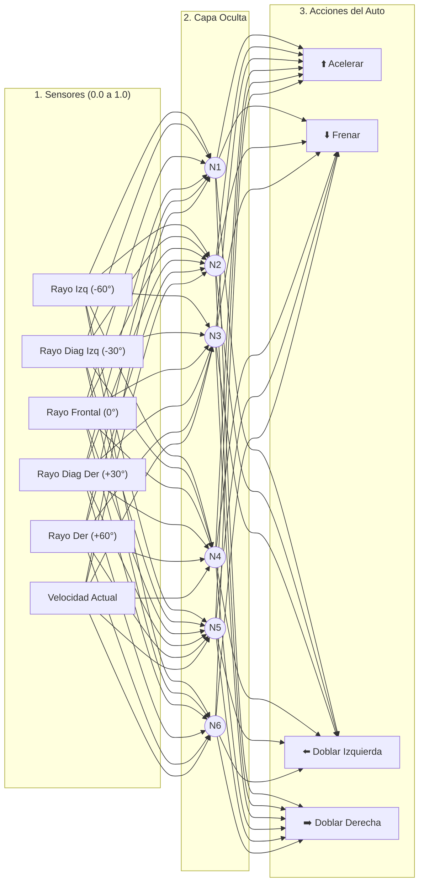
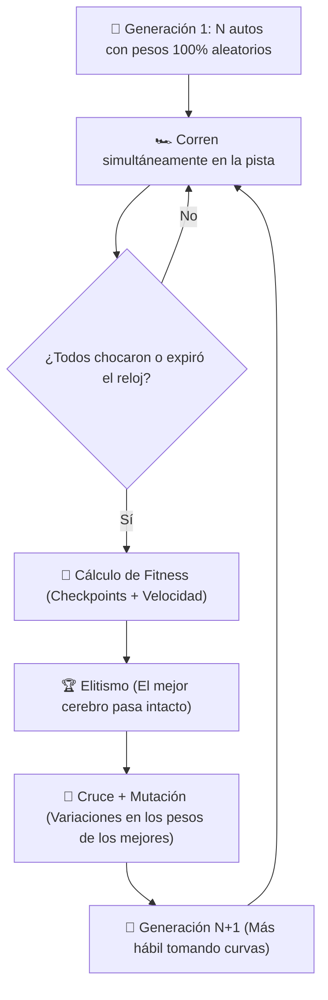
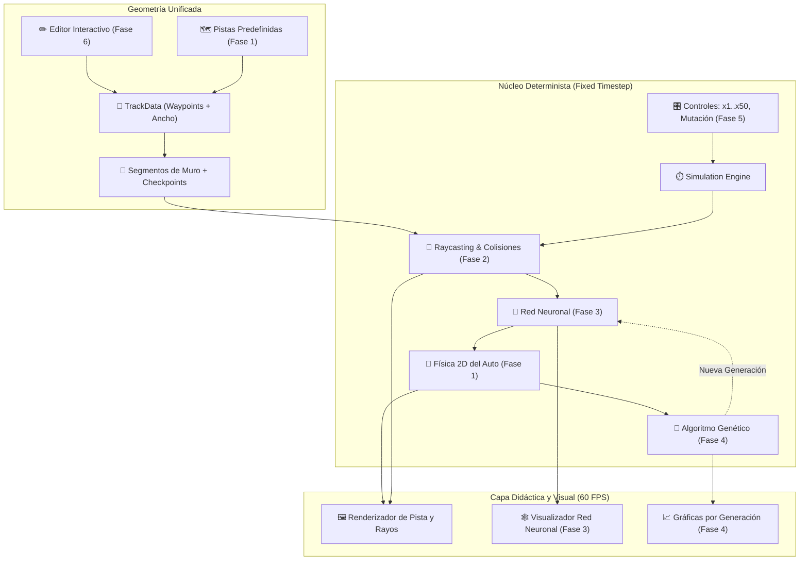

# 🏎️ NeuroRace 2D — Laboratorio Visual de Aprendizaje Autónomo


-orange?style=for-the-badge)


> **Un simulador interactivo, visual y didáctico en 2D donde una población de autos aprende desde cero a conducir, frenar y doblar en distintos circuitos mediante Redes Neuronales y Algoritmos Genéticos (Neuroevolución).**

---

## 🎯 Propósito del Proyecto

¿Cómo puede un programa aprender a manejar y tomar curvas sin que nadie programe reglas como *"si viene una curva, gira a la derecha"*?

**NeuroRace 2D** está diseñado para **abrir la "caja negra" de la Inteligencia Artificial** de forma totalmente gráfica e interactiva directamente en el navegador:
1. **Percepción visible:** Verás los rayos láser (*raycasts*) con los que cada auto mide distancias a los bordes.
2. **Pensamiento en vivo:** Observarás las neuronas y conexiones del auto líder encendiéndose en tiempo real mientras decide acelerar, frenar o doblar.
3. **Evolución medible:** Analizarás en gráficas cómo cada generación supera a la anterior.
4. **Experimentación total:** Podrás acelerar el tiempo (`x1` a `x50`), modificar la mutación en vivo y **dibujar tus propios circuitos** para poner a prueba a la IA.

---

## 🖥️ Vista Conceptual del Laboratorio Interactivo

```text
+-------------------------------------------------------+-----------------------------------+
|  🏁 LIENZO PRINCIPAL 2D (Modo Carrera / Modo Editor)  |  🧠 RED NEURONAL EN VIVO (Líder)  |
|                                                       |                                   |
|         ==================================            |    (S1) ──\                       |
|        /     \   |   /                    \           |    (S2) ───●──\     [ ⬆️ Acelerar]|
|       /       \  |  /    🏎️💨 (Líder)      \          |    (S3) ───●───●─── [ ⬇️ Frenar  ]|
|      |     -----[🚗]----->                  |         |    (S4) ───●──/     [ ⬅️ Izq     ]|
|      |        👻  👻  (Población activa)    |         |    (S5) ──/         [ ➡️ Der     ]|
|       \       💥 (Eliminado)      ✏️ [Nodos]|         |    (Vel) ─/                       |
|        \__________________________________/           |-----------------------------------|
|                                                       |  📈 PROGRESO POR GENERACIÓN       |
|  [🏁 Simular] [✏️ Editar Pista] [👁️ Rayos: Líder/Todos]|  Fitness |        _.-~^~          |
|-------------------------------------------------------|          |    _.-~  (Mejor/Prom)  |
|  🎛️ CONTROLES DE SIMULACIÓN EN CALIENTE               |          +----------------------> |
|  • Velocidad: [x1] [x5] [x10] [x50]  • Gen: #18       |            G1   G5   G10   G18    |
|  • Población: [100]   • Mutación: [===o----] 8%       |  • Vivos: 24 / 100 | Récord: 1.8v |
+-------------------------------------------------------+-----------------------------------+
```

### 🎨 Código Visual y Didáctico
| Elemento en Pantalla | Qué Representa |
| :--- | :--- |
| 🟢 **Auto Líder + Rayos Graduales** | El auto más avanzado. Sus rayos cambian de **verde** (despejado) a **rojo** (muro muy cerca). *También puedes hacer clic en cualquier auto para inspeccionarlo.* |
| 👻 **Población Semitransparente** | El resto de la generación compitiendo en paralelo (no chocan entre sí, solo contra los bordes del circuito). |
| 🟦 / 🟥 **Sinapsis de la Red** | **Azul/Verde** = peso positivo (excita la acción), **Rojo** = peso negativo (inhibe la acción). El **grosor** muestra qué tan fuerte es esa conexión. |
| 📈 **Curvas de Aprendizaje** | Comparativa entre el **Mejor Fitness** (pico de talento) y el **Fitness Promedio** (qué tan bien maneja toda la especie). |
| ✏️ **Nodos del Editor de Pista** | Puntos de control arrastrables que generan automáticamente los bordes del asfalto y los *checkpoints* invisibles de puntuación. |

---

## 🧠 ¿Cómo Aprenden los Autos? (Explicación Paso a Paso)

### 1. Percepción: Sensores de Distancia (*Raycasting*)
Cada auto proyecta un abanico de rayos frontales y diagonales. Matemáticamente, el auto solo recibe una lista de números entre `0` y `1` (qué tan cerca está el muro en cada ángulo) más su velocidad actual.

```text
              \    |    /
            S2 \   |S3 / S4
                \  |  /
         S1 _____\_|_/_____ S5
                 [ 🚗 ] ───► Vector de velocidad
```

### 2. Decisión: Red Neuronal *Feedforward*
Esos números entran al "cerebro" del auto. Cada capa multiplica las entradas por **pesos** ($W$), suma un **sesgo** ($b$) y aplica una función de activación (`tanh`) para decidir qué pedales y hacia dónde mover el volante:



### 3. Evolución: Selección Natural por Generaciones
Nadie entrena un auto corrigiéndolo a mano; entrenamos **toda una especie** a lo largo de generaciones:



---

## 🏗️ Arquitectura Escalable (Cómo Evitamos que las Piezas Choquen)

Para que las **6 funcionalidades** crezcan de forma fluida sin tener que reescribir código en cada etapa, el proyecto se apoya en **4 decisiones de arquitectura desacoplada** desde el día uno:

> [!IMPORTANT]
> **Reglas de Oro del Diseño Modular**
> 1. **Física con Paso Fijo (`Fixed Timestep`) separada del Dibujo:** `Simulation.step(FIXED_DT)` calcula física e IA de forma determinista, independiente de `Renderer.draw()`. Así, cuando en la Fase 5 agreguemos velocidad `x10` o `x50`, simplemente ejecutaremos 10 o 50 *steps* matemáticos por cada cuadro dibujado, **sin que los autos atraviesen paredes ni cambie su comportamiento**.
> 2. **Pista Basada en Nodos (`TrackData`), nunca estática:** Desde la Fase 1, cualquier pista se define como una lista de puntos centrales (*waypoints*) + ancho de carril. Un generador geométrico convierte esos puntos automáticamente en **muros izquierdo/derecho (segmentos)** y **checkpoints perpendiculares**. Gracias a esto, cuando construyamos el **Editor de Circuitos**, cualquier pista que dibujes funcionará al instante con los sensores y el cálculo de *fitness* sin tocar la IA.
> 3. **Controlador Abstracto (`CarController`):** La clase `Car` no sabe si la maneja un humano o una red neuronal; solo recibe `{ throttle, brake, steer }`. Esto permite probar las físicas con teclado en la Fase 1, conectar la IA en la Fase 3 e incluso correr humano vs. IA más adelante.
> 4. **Telemetría por Eventos / Estado Lectura:** Los paneles visuales (visualizador neuronal, gráficas, estadísticas) solo **leen** instantáneas del motor de simulación sin ensuciar la lógica física.



---

## 🗺️ Plan de Desarrollo por Fases (Fluido y Acoplable)

Cada fase entrega un producto funcional y deja listos los "enchufes" exactos que necesita la siguiente:

### 🔹 Fase 1: Cimientos — Motor 2D, Física del Auto y `TrackData`
* **Qué construimos:** Configuración de TypeScript + Vite, bucle `Fixed Timestep`, física 2D con aceleración, freno, fricción y derrape suave, interfaz `CarController` (con control por teclado para calibrar el manejo) y generador de circuito a partir de *waypoints* (`TrackData`) que produce muros y *checkpoints*.
* **Por qué va primero:** Garantiza que manejar se sienta natural y establece la estructura geométrica universal que usarán tanto los sensores como el futuro editor de pistas.

### 🔹 Fase 2: Percepción — Sensores *Raycasting* en Tiempo Real y Colisiones
* **Qué construimos:** Matemática de intersección rayo-segmento y polígono-segmento contra los muros de `TrackData`.
* **Entregable Visual #1 (Raycasts):** Dibujo en vivo de los rayos sensores sobre el auto, con degradado de color según proximidad al muro, puntos de impacto iluminados y selector de vista (*solo auto líder / auto seleccionado / todos*).
* **Cómo se acopla:** Consume directamente los segmentos de `TrackData` (Fase 1) y entrega un arreglo limpio de lecturas normalizadas `[0..1]` listo para alimentar a la IA.

### 🔹 Fase 3: El Cerebro — Red Neuronal y Visualizador en Vivo
* **Qué construimos:** Clase `NeuralNetwork` desde cero (capas configurables, pesos, *biases*, propagación *feedforward*) implementando `CarController`.
* **Entregable Visual #2 (Visualizador Neuronal):** Segundo `<canvas>` sincronizado que dibuja en tiempo real las capas del cerebro del auto activo, iluminando neuronas según su nivel de activación y coloreando conexiones según el peso y la señal que circula por ellas.
* **Cómo se acopla:** Toma las lecturas de `Sensor` (Fase 2) y entrega `{ throttle, brake, steer }` a `Car` (Fase 1) sin modificar una sola línea de la física.

### 🔹 Fase 4: Evolución — Poblaciones, Algoritmo Genético y Gráficas
* **Qué construimos:** `PopulationManager` (50–200 autos en paralelo), cálculo de *Fitness* mediante los *checkpoints* de `TrackData`, detección de estancamiento (timeout si un auto no avanza), *Elitismo*, *Cruce* y *Mutación*, más seguimiento automático de cámara/foco al auto líder.
* **Entregable Visual #3 (Gráficas de Progreso):** Panel estadístico en vivo con curvas de evolución por generación (*Mejor Fitness*, *Fitness Promedio*, *Autos Vivos* y *Vueltas completadas*).
* **Cómo se acopla:** Orquesta múltiples instancias de `Car + NeuralNetwork` (Fases 1–3) y emite un resumen al final de cada generación hacia el módulo de gráficas.

### 🔹 Fase 5: Laboratorio — Controles de Simulación y Persistencia
* **Qué construimos:** Panel interactivo de hiperparámetros y herramientas de experimentación.
* **Entregable Visual #4 (Controles de Simulación):**
  * Botones de velocidad temporal (`x1`, `x2`, `x5`, `x10`, `x50`, `Pausa`) ejecutando múltiples ticks del motor determinista por frame.
  * Sliders para ajustar en caliente **tasa de mutación**, **intensidad de mutación**, **tamaño de población** y **geometría de sensores** (cantidad y ángulo de rayos).
  * Guardar / Exportar / Cargar el mejor cerebro en `JSON` o `localStorage` ( y modo opcional *"Reta al Campeón"* manejando tú un auto contra la IA).
* **Cómo se acopla:** Aprovecha el `Fixed Timestep` diseñado en la Fase 1, por lo que acelerar el tiempo es instantáneo y 100% estable.

### 🔹 Fase 6: Creatividad — Editor Interactivo de Circuitos
* **Qué construimos:** Herramienta visual *"Dibuja tu Pista"* integrada en el mismo lienzo principal.
* **Entregable Visual #5 (Editor de Circuitos):**
  * Crear pistas haciendo clic para añadir nodos, arrastrar curvas (*splines* suaves), ajustar el ancho del asfalto, cerrar el circuito y definir la línea de salida.
  * Catálogo de pistas predefinidas (Óvalo Escuela, Circuito en "8"/S, Horquillas Técnicas) + importación/exportación de pistas creadas por el usuario.
* **Cómo se acopla:** El editor simplemente exporta un objeto `TrackData` (el mismo formato de la Fase 1). Al pulsar **"¡Entrenar aquí!"**, los muros, colisiones, rayos y *checkpoints* funcionan automáticamente sin tocar ningún otro módulo.

---

## 🗂️ Estructura del Proyecto

```text
Redes/
├── index.html                  # Layout tipo dashboard (Lienzo + Paneles didácticos)
├── src/
│   ├── main.ts                 # Inicialización y coordinación general
│   ├── core/
│   │   ├── Simulation.ts       # Bucle Fixed-Timestep (soporta x1..x50 sin romper físicas)
│   │   └── Types.ts            # Contratos compartidos (TrackData, CarInputs, GenStats)
│   ├── world/
│   │   ├── Track.ts            # Generador de muros y checkpoints desde nodos (Splines)
│   │   ├── Car.ts              # Dinámica 2D del vehículo desacoplada del controlador
│   │   ├── Controllers.ts      # KeyboardController y NeuralController
│   │   └── Sensor.ts           # Raycasting y cálculo de intersecciones geométricas
│   ├── ai/
│   │   ├── NeuralNetwork.ts    # Red Feedforward desde cero + serialización JSON
│   │   └── GeneticAlgorithm.ts # Fitness, elitismo, cruce (crossover) y mutación
│   └── ui/
│       ├── TrackRenderer.ts    # Dibujo del circuito, autos, efectos y rayos sensores
│       ├── NetworkVisualizer.ts# Grafo animado en vivo de neuronas y pesos
│       ├── ProgressChart.ts    # Gráficas históricas de fitness por generación
│       ├── SimControls.ts      # Controles de velocidad, mutación y guardado de cerebros
│       └── TrackEditor.ts      # Modo interactivo para crear y modificar circuitos
└── README.md
```

---

## 📈 Evolución Esperada Durante una Sesión

| Generación | Qué Verás en la Pista | Qué Verás en la Red y Gráficas |
| :---: | :--- | :--- |
| **Gen 1 – 3** | Choques inmediatos, autos dando trompos o quedándose quietos. | Pesos caóticos; el *Fitness* sube de golpe apenas un auto descubre el acelerador. |
| **Gen 4 – 10** | La manada avanza rápido en rectas y empieza a doblar en la primera curva. | Conexiones marcadas entre los rayos laterales y el giro en sentido contrario. |
| **Gen 11 – 25** | Los líderes enlazan curvas en "S" y esquivan bordes estrechos. | La curva de *Fitness Promedio* alcanza al líder: toda la población ya sabe doblar. |
| **Gen 25+** | Vueltas completas fluidas; regulan velocidad antes de horquillas cerradas. | Ajustes finos en la red; momento ideal para subir velocidad a `x10` o editar la pista. |

---

## 🚀 Ejecución Local *(Próximamente en Fase 1)*

```bash
# 1. Instalar dependencias ligeras (Vite + TypeScript)
npm install

# 2. Iniciar el laboratorio en modo desarrollo
npm run dev
```

---

## 📖 Glosario Rápido

* **Raycasting:** Técnica geométrica que lanza líneas invisibles desde el auto para medir a qué distancia exacta están las paredes.
* **Red Neuronal *Feedforward*:** Función matemática en capas donde la información fluye en un solo sentido: *Sensores $\rightarrow$ Neuronas Ocultas $\rightarrow$ Volante/Pedales*.
* **Peso (*Weight*) y Sesgo (*Bias*):** Los "genes" numéricos del cerebro del auto. Determinan qué importancia le da a cada sensor.
* **Fitness (Aptitud):** Puntaje obtenido según cuántos *checkpoints* superó el auto y qué tan rápido lo hizo.
* **Elitismo y Mutación:** Conservar intacto al mejor campeón mientras sus descendientes reciben pequeños retoques aleatorios para descubrir mejores maniobras.
